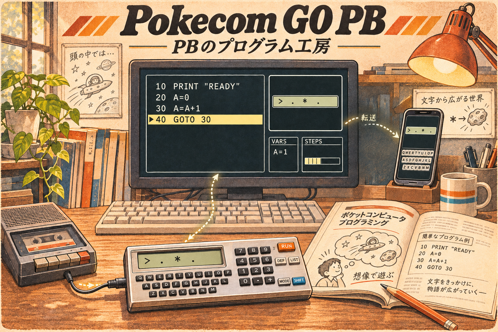

# Pokecom GO PB

**PBのプログラム工房**

旧PB-100愛好家のための、CASIO PB-100系互換BASICアプリのリメイクプロジェクトです。
昔のコードを読み解き、磨き、スマホや実機へ持ち出す体験を目指します。

現在は要求仕様の整理と基本設計の段階です。主要技術はKotlin Multiplatform＋Compose Multiplatformを方針として選定し、実装はまだ始めていません。

- [要求仕様書](docs/requirements.md)
- [BASIC詳細仕様（pokecom2実装基準）](docs/basic-specification.md)
- [基本設計（第1版・ドラフト）](docs/basic-design.md)
- [主要技術の選定](docs/technology-selection.md)
- [技術選定 第2段階（実行制御・保存・周辺連携）](docs/technology-selection-details.md)
- [バージョン構成・数値計算・iOS共通基盤の評価計画](docs/version-and-foundation-evaluation.md)
- [システム設計・実装計画案](docs/design-and-implementation-plan.md)
- [追加インプット記録](docs/input-notes.md)
- [特殊記号・エスケープ仕様](docs/references/escape-codes.md)
- [既存WAV変換スクリプトの調査](docs/references/pbsavea-review.md)
- [旧Pokecom GOの実装調査](docs/references/pokecom2-analysis.md)

デスクトップ（Windows / macOS / Linux）を先行し、Android / iOSのPlayerを後続で検討します。BrainuxやWindows CEなどの環境は、低い優先度で将来対応を検討しています。詳細な機能と公開範囲は要求仕様書を参照してください。
