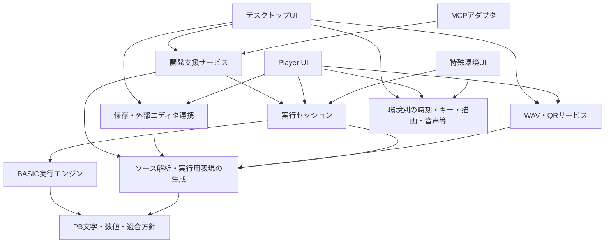

# Pokecom GO PB 基本設計

作成日: 2026-11-03 / 第1版・設計ドラフト

本書ではシステムの責務・データ・実行制御・接続境界を定義する。以下の設計方針は実装前のレビュー対象とし、未確定の言語仕様や技術選定まで決定済みとは扱わない。コード・試作は未着手。

技術方針の更新: [主要技術の選定](technology-selection.md)でKMP＋Composeを選定。Windows CE／Brainuxは必要なら対象外としてよく、主要5OSを優先する。以下の技術未選定や特殊環境に関する初期記述より、この更新を優先する。

参照: [要求仕様](requirements.md)、[BASIC詳細仕様](basic-specification.md)、[設計・実装計画](design-and-implementation-plan.md)、[旧版調査](references/pokecom2-analysis.md)。

実装方式の具体化は [技術選定 第2段階](technology-selection-details.md) を参照する。Coroutinesによる単一セッション処理、StateFlowと必須応答の分離、JSONと通常テキストの分離、ローカルMCP接続を方針として選定。基本設計の未確定記述は、選定書に記す範囲で具体化した。

## 1. 設計の前提

- BASICの基準はpokecom2の固定コミット`9deb46a3c37c6cc2ae860cfc42df4297a4cf3988`から整理した詳細仕様。独自拡張・不整合は別に判断する。
- デスクトップはWindows/macOS/Linuxでの制作・読解・デバッグ・AI活用。最初に提供する環境とする。
- PlayerはAndroid/iOSでの実機風操作・実行・編集。解析系の機能は搭載しない。
- Brainux等は低優先度、Windows CEの対象はBrainでかなり低優先度。主要5OSの方式を優先し、両者は必要なら対象外にする。KMPからの移植を保証しない。
- 共通の実行意味を保ちつつ、UI、容量制限、開発支援の有無を変える。特殊環境のために別のBASICを実装する方式を第一案にはしない。
- タイムトラベル、Web、投稿サービスは基本設計の必須条件にしない。

## 2. システム構成と依存方向



矢印は利用方向。表示・入力はセッションから返される要求・イベントをUI側が処理して応答する。CoreがDeviceやUIを直接呼ぶ構造にはしない。図は論理分割で、箱ごとの別プロセス化を要求しない。PlayerのTransferはQR取込に限定し、WAVや解析機能を意味しない。

| 論理モジュール | 責務 | 含めないもの |
| --- | --- | --- |
| PB共通モデル | PB文字、数値値、ページ・行、対象方言、容量方針、エラー分類 | OS API、UI文字列の翻訳 |
| ソース解析 | テキスト・エスケープの解析、PB文法、式、命令、原文位置、容量計数用表現 | ウィンドウ操作、外部エディタ起動 |
| BASIC実行エンジン | 式評価、命令、変数、FOR/GOSUB、継続処理 | sleep、描画、カメラ、ファイル読書き、ネットワーク |
| 実行セッション | ソース版と実行状態の所有、操作の直列化、実行量・待機・速度の管理 | UIレイアウト、AIモデル呼出し |
| 開発支援 | 命令分解表示用情報、状態参照、変数変更、診断、ソース改変案 | 別系統の式評価・容量計数 |
| テキスト保存 | ファイル、旧保存形式、読込・保存、外部変更の通知 | 実行中の無条件な差し替え |
| WAV/QR | 符号化・復号、転送適合確認、WAV診断 | BASICの命令実行 |
| 環境別UI・接続 | LCD、キー、ゲームコントローラ、ファイル選択、カメラ、描画、音声、日英UI | 独自のPB文法解釈 |
| MCP | 開発支援の操作を外部AIへ公開、要求と結果の変換 | AI専用の状態変更経路 |

## 3. 共通データモデル

名称は概念名で、言語や公開APIの型名を確定するものではない。

| データ | 内容・不変条件 |
| --- | --- |
| SourceDocument | ファイル等から受け取った原文と文書版。改行・空白・省略表現を保持する |
| SourceRevision | 読込・編集ごとの版識別子。過去の版を必ず永続保存する意味ではない |
| ProgramSet | P0〜P9の行群。ページと行番号で識別し、実行順は行番号順 |
| SourceSpan | 原文中の開始・終了位置。Unicode・改行・エスケープ展開後の位置へ対応付ける |
| PBText | PB文字の列。文字としてのコードと、予約語・命令区切りトークンを区別 |
| Expression | PBの優先順位・省略規則を反映した式の構造 |
| Instruction | 命令ID、命令種別、引数、後続・分岐先情報、元ページ・行・原文範囲 |
| ExecutableProgram | 特定のソース版から生成した命令群、行番号検索表、方言・解析版情報 |
| DebugMap | 原文と命令の対応、分解表示情報。開発用途で付与し、簡易実行では省略可能にする |
| MachineState | 変数、追加領域、独立文字列、角度・表示設定、FOR/GOSUB、実行位置、命令継続状態 |
| DisplayState | LCDの12文字セル、必要な表示属性、出力全体とスクロール位置、入力編集状態 |
| CapacityReport | コード・追加変数の使用量、合計、対象容量、超過量、未確認項目 |
| Diagnostic | 構文・互換・容量・実行・ホストの分類、番号、引数、原文位置、重要度 |

### 原文・内部表現・実機データ

原文をPB文字列へ変換しても原文自体は置き換えない。1文字のPB記号がテキストでは複数字になる場合、対応範囲を明示する。

容量計数は実機向けのトークン・文字・行構造から求める。実行命令オブジェクトやメモリ上の式のサイズをステップ数へ転用しない。WAVにも同じ実機コード変換定義を使うが、カセット枠・ヘッダ等の転送バイト数とプログラム容量は区別する。

外部ファイルにある行番号と、ファイル上の物理行番号は別々に保持する。重複行、無効行、未対応文字を黙って捨てず、読込診断で確認できるようにする。旧版同様に無視する入力を許す場合も、その方針を明示する。

## 4. 言語処理の流れ

1. 原文と文書版を受け取る。
2. ページ指定・行番号・文字とエスケープを読み、原文対応を作る。
3. pokecom2基準の省略記法を扱う字句・構文解析を行う。
4. 式と命令の構造を作り、行内の命令と制御の流れを明示する。
5. 実行用表現と、必要に応じたDebugMapを生成する。
6. 実機向け容量・対象適合を別途報告する。

予約語、引数規則、実機コード、容量への寄与は相互参照できる定義とする。旧版の三つの表の不一致は引き継がない。予約語が解析できること、実行できること、実機へ符号化できることを別の能力として持つ。

直接入力も共通の解析器・式評価を使う。直接入力用とプログラム用では許可する命令・編集操作を切り替え、数値計算の別実装は作らない。プログラム一時停止中に直接入力をそのまま重ねて実行する機能は初期案に含めず、変数変更は専用操作で行う。

全行の構文を先に確認する設計は、実行時まで誤りを検出しない旧版とタイミングが異なる可能性がある。到達しない行のエラー、実機風編集での未完成行は方言・読込診断の課題として残す。未完成の編集用ソースと、実行可能な版を分ける。

## 5. 命令単位の定義とステップ実行

### 初期定義案

| 構文 | 1回の命令単位実行で扱うこと |
| --- | --- |
| 代入・VAC等 | 1命令を完了する |
| IF | 条件を評価して次の実行位置を選ぶ。真の後続命令は別の単位 |
| FOR | 初期値・終値・増分を評価し、ループ状態と次位置を設定 |
| NEXT | 対象のループ変数を更新し、継続／終了を選ぶ |
| GOTO / GOSUB / RETURN | 分岐・戻り先状態を更新し、移動先の命令の前で止まる |
| PRINT | 1つのPRINT文全体。ただしスクロールやカンマ等の待機では途中でホストへ戻る |
| INPUT | 1つのINPUT文全体。複数項目の入力待ちは同じ命令の継続として扱う |
| STOP / END | STOP文待機／終了へ遷移する |
| 行番号・コロン | ソースの構造であり、単独の停止対象に数えない |

内部的な分岐処理・式評価の小処理を、デバッグ上の1命令と同一視しない。IFの分解位置は元の条件と後続の範囲へ対応付ける。FOR・GOSUB等の解釈に必要な順序を保ち、最適化で読解対象の命令を消さない。

例示用ソース（UI動作説明用。実機での受入サンプルは別途確認）:

```text
10 A=1:IF A=1;PRINT "OK":A=A+1
```

分解表示は「A=1」「IF A=1」「PRINT "OK"」「A=A+1」に対応させる。IFが偽ならその行の残りを飛ばす。PRINTが待機すれば、その命令を進行中として表示し、完了したものとして扱わない。

### 途中で待機する命令

実行結果は「命令完了」「入出力・時間待ち」「終了」「エラー」のいずれかを返す。PRINTやINPUTでは、評価済みの引数、残りの要素、出力済み位置などを継続状態へ保存する。

再開時に乱数・キー参照・変数の読み取りや既に出した文字を重複処理しない。引数をいつ評価するかはpokecom2の処理順に従って詳細化し、全引数を無条件に先行評価する方式にはしない。

「1命令実行」も入力待ちを自動で突破しない。待機解除後にその命令を完了し、次の命令の直前でデバッガ停止する。無限待ちのままUI呼出しを占有しない。

## 6. 実行状態と遷移

状態は、終了状況、デバッガの制御、BASIC自身の待機理由を分けて持つ。単一のpauseフラグへまとめない。

| 軸 | 値の例 |
| --- | --- |
| ライフサイクル | 未ロード、実行可能、実行中、正常終了、中断終了、異常終了 |
| 実行制御 | 連続実行、1命令実行、デバッガ停止 |
| BASIC側の待機 | なし、INPUT、PRINT確認、STOP文、スクロール時刻待ち |

デバッガ停止中でも、INPUT待ち等の元の状態は保持する。セッション表示では「入力待ち中に停止」等の組合せを表せる。基本APIで状態を参照できることと、Playerへ解析画面を搭載することは別。

| 操作・出来事 | 動作 |
| --- | --- |
| 新規RUN | 実行位置・FOR/GOSUB・保留入出力を新規にする。変数・角度・表示設定は明示的な初期化方針に従う |
| デバッガ一時停止 | 安全な命令境界、またはホストへ戻った待機点で実行を保留 |
| デバッガ再開 | 連続実行へ戻る。BASIC側の待機があれば保持し、EXEや入力の代わりにはしない |
| 1命令実行 | 1命令完了まで進める。待機点では状態を返し、完了後は次の命令前で止める |
| INPUTの確定 | 対応する入力要求だけを解決する。停止中なら確定処理を保留し、暗黙に再開しない |
| EXE | PRINT待ち・STOP文等の対応するBASIC待機を解除。デバッガ停止は解除しない |
| 実行終了要求 | 待機を含めて中断終了し、以降の応答を失効させる |
| END・終端 | 正常終了。観察用の最終状態は参照できる |
| 実行エラー | 異常終了し、原因位置と状態を保持。初回案ではエラー後の途中再開は行わない |

RUNで変数を自動消去しない旧版の動作を基準にする一方、FOR/GOSUB等の制御スタックは新規RUNで初期化する設計案とする。これは旧版の不整合の修正候補として記録する。VACとセッション全体のリセットは別の操作。

PlayerのSTOPキーを終了にするか再開可能な停止にするかは、旧版動作と新要求を照合して未決とする。UIからは「デバッガ停止」「BASICのSTOP文」「終了要求」を区別して呼べる構造にする。

## 7. セッションAPIの契約

具体の関数名や通信形式は未確定。以下の操作単位を基本契約とする。

| 操作 | 入力・条件 | 結果 |
| --- | --- | --- |
| 解析・検証 | 原文、ソース版、方言、対象設定 | 診断、実行用表現、原文対応、容量報告 |
| プログラム読込 | 実行可能な版。初期案は実行中の差し替えを禁止 | 読込版と実行可能状態 |
| 直接コマンド | コマンド文字列、RUN/PRO等の操作モード | 結果表示、変数変更、編集／実行要求等 |
| 実行開始 | ページ、任意の開始行、実行設定 | 新しい実行ID |
| 実行を進める | 命令数・内部処理量等の上限、経過時間等 | 更新、待機、完了命令数、残る実行状態 |
| 停止・再開・1命令実行・終了 | 実行IDと許可された操作 | 更新後の状態、または操作不可の理由 |
| キー更新・EXE | 論理キーの状態／操作、実行ID | 入力状態や待機の更新 |
| 入力確定・表示待機の応答 | 実行ID、要求ID、入力値等 | 対応要求の解決。二重・古い応答は拒否 |
| 状態参照 | 実行ID、必要な表示項目 | コピーまたは読み取り専用の状態版 |
| 変数変更 | 実行ID、期待する状態版、対象領域、型付き値 | 検査後に一括適用、状態版更新 |

すべての実行状態変更をセッションの単一の処理経路へ集める。UI・MCP・タイマーが同時に来ても、その場でCoreを並行呼出ししない。スレッド方式は技術選定後に決めるが、状態の書込み主体は一つとする。

実行IDはRUNごと、状態版は観測可能な変更ごとに更新する。入力要求ID・イベント順序を使い、前回実行のキー・入力応答・描画応答が次のRUNへ混ざらないようにする。描画そのものの完了を、BASICのEXE確認と混同しない。

実行時間上限だけに頼らず、処理量を区切って戻れる構成にする。長い式の計算や解析にも資源上限と終了要求の扱いを設ける。時間値・上限数値の詳細は性能試作で決める。

## 8. 停止中の変数変更

- 初期案ではデバッガが安全な命令境界で停止している場合に限る。INPUT・PRINT等の途中待機中は状態参照を許し、変数変更は受け付けない。
- 値は共通の数値／文字変換で検査し、文字数・領域・型・容量に適合しない変更を拒否する。任意のBASIC文を実行して書き換える機能とは分ける。
- AとA$、添字の共有領域を同じ規則で扱う。画面上の別名による二重管理を作らない。
- FORの制御変数を変更した場合は次のNEXTが変更後の値に増分を加える。終値・増分・戻り先は、変数変更だけでは変更しない案とする。
- FOR/GOSUBの内部スタックの直接書換えは初期案の対象外。
- 変更前後の値と位置を開発用の操作記録に残せる。これは命令履歴の巻き戻し機能ではない。

## 9. 入出力・LCD・キー・時間

Coreは「PB文字列を出す」「入力を求める」「確認を待つ」「キーを読む」等を表し、セッションが共通の表示状態と待機状態を管理する。UIは受け取った状態を描く。

- 12セルはPB文字の単位。Unicodeの表示幅や文字列長で代用しない。
- 字形は固定キャラクタ表から描画し、UIが自由なゲーム用グラフィックへ置き換えない。
- PRINTの連結、CSR、数値整形、スクロール順序は共通部分で定義し、OS別UIで再実装しない。
- スクロールは期限付きの継続状態とする。セッションが時間の進行を受け、次の12セルを返す。初期値は旧版の800ms／300msを候補とし、確定値とはしない。
- BASICの実行速度、LCDの表示送り、UI描画の頻度を別設定として扱う。高速実行でも入力イベント処理を飢餓状態にしない。
- 入力編集中の文字列・カーソル・挿入削除は共通の対話入力モデルを利用する。Playerの実機風行長制限と、デスクトップの入力支援は方針として切り替える。
- ハードキーのLogical/Physical、ソフトキー、ゲームコントローラは、環境側で共通の論理キーへ変換する。BASICのKEYは論理キー状態を参照する。
- 編集用の文字入力と、KEYが読む押下状態は区別する。リピートやフォーカス消失時のキー解放も環境側から通知する。
- 乱数は差し替え可能な供給元を使う。通常は通常の乱数、試験では再現可能な列を使う。タイムトラベル用の保存形式は設計対象外。

## 10. 対象方針・容量・転送

対象設定は次の三つを分ける。

1. **言語・機種の方針**: 採用命令、数値・省略規則、未対応事項。
2. **容量の方針**: 制限なし／544／1,568、追加変数との関係。
3. **利用機能**: デバッグ、テキスト編集、QR、WAV、AI等の提供範囲。

デスクトップの容量制限なしを、文法・数値範囲まで無制限にする意味にはしない。Playerと特殊環境でも実行の意味は共通にする。

CapacityReportは、算定した版・対象・コード使用量・追加変数使用量・超過量を持つ。DEFM等で実行中にメモリ構成が変わる場合も更新する。正確な計数規則が未確認なら、その結果を確定の実機適合と表示しない。

転送判定は容量だけでなく、対象命令・文字・行長・未確認要素も評価する。結果は「適合」「不適合」「未確認」に分ける。禁止か警告継続かのUI方針は未決で、変換器が黙って切り捨てる処理は設けない。

WAV生成・QR出力は同じソース版と判定を使う。ソース転送と実行スナップショット転送は別であり、初期のQRに実行状態は含めない。QRの形式・圧縮・分割は後続設計で定める。

WAV復号は「音声→信号区間→ビット・フレーム→PBデータ→テキスト」の各段階に診断位置を持たせる。波形解析UIはその結果を参照し、復号器自体をUIへ埋め込まない。品質条件は別途設計する。

## 11. デスクトップ・Player・特殊環境

| 環境 | 共通部分 | 環境側の責務 |
| --- | --- | --- |
| デスクトップ | 言語処理、実行、入出力、容量、文字 | 外部ソース読込、LCD、原文・分解表示、変数・ループ・戻り先、各種操作、WAV/QR、MCP |
| Player | 同じ言語処理・実行・入出力、544/1,568の制限 | 実機風本体・キー、手入力、通常テキスト読込、QRカメラ、一覧の上下送り |
| 特殊環境 | 必要な言語処理・実行・入出力 | 簡易LCDと入力、プログラム読込。解析、WAV、QR、MCPは必須にしない |

Playerの手入力は共通ソースモデルに反映し、検査後に実行版へ変換する。外部テキストやQRだけに依存しない。Playerには解析画面を載せないが、実行に必要な構文解析は行う。

デスクトップは外部エディタを編集の主体とし、原文表示は読み取り専用を初期案とする。アプリが読んだ版とディスク上の最新版を区別する。外部変更があっても実行中の版を自動置換しない。明示再読込を初期案とし、保存時自動反映は後で追加できる境界に置く。

特殊環境ではDebugMap、状態監視通知、履歴等を外せる構成にする。実行に必要なFOR/GOSUB状態等は当然保持する。ソース解析を端末に含めるか事前変換するかは機器条件を見て判断し、事前変換形式を採用する場合は版管理を別途設計する。

Windows CEのOS版・CPU・ツールチェーン、Brainuxの対象機器は未確認。現時点でC ABI、特定の言語標準、特定ランタイム、共通バイナリの利用を決めない。少ない環境依存と明確な入出力境界を確保し、技術選定時に実際のビルド可能性を調べる。

## 12. MCPとAI開発支援

MCPは、デスクトップと同じ開発支援サービスを使う。接続方式・公開範囲・起動方式は技術選定後に決める。

想定する操作は、ソース取得、解析・診断、容量確認、実行位置・変数等の参照、ソース変更案の提示、適用、実行制御。実行・変更を公開する場合も実行ID・ソース版・状態版の検査を通す。

AIが作ったソースを自動的に実行中の版へ上書きしない。差分・診断・対象適合を確認した候補版として扱う。説明資料はソース版や確認結果へ結び付け、AIの説明と実測結果を区別できるようにする。

MCPなしでも開発・実行できる構成とする。Playerや特殊環境の起動にMCPサービスを必須としない。外部エディタ連携のための専用拡張も必須にしない。

## 13. 保存・エラー・資源上限

- 初期の交換・保存基準は旧テキスト形式と既定エスケープ。新しいプロジェクト用メタ情報を持つ場合も、実機向けソースへ混ぜない。
- ソースの版と、実行中の状態を別々に持つ。アプリ終了後の実行状態復元は現時点で必須にしない。
- BASICエラーは旧番号を基準に整理する。ホストI/O失敗、メモリ確保失敗、MCP操作の競合等を、無理に同じ番号へ押し込まない。
- 診断は機械向け分類と引数を持ち、UIで日本語／英語へ翻訳する。ソース内の文字列やPB文字をUI言語切替で変更しない。
- ソース、式の深さ、FOR/GOSUB、追加変数、処理量、出力長等の資源上限を設ける。具体値は未決で、実機由来の上限とホスト保護の上限を区別する。
- 不正な入力・資源超過でセッション全体やUIが応答不能にならないことを受入条件に含める。

## 14. 設計の検証条件

| 観点 | 確認すること |
| --- | --- |
| 言語基準 | pokecom2由来の仕様であること、正常動作・独自拡張・不整合を混同していないこと |
| 原文対応 | 空白省略・閉じ括弧省略・エスケープを含め、実行位置が元の文字範囲へ戻ること |
| 命令実行 | IF、ループ、分岐、戻りで停止単位が説明できること |
| 待機の継続 | PRINT/INPUT途中で何度ホストへ戻っても、表示・入力・乱数等の副作用が重複しないこと |
| 実行の一致 | 変数を変更しない場合、連続実行と命令単位実行で同じ論理入力・時刻・乱数列に対し結果が一致すること |
| 停止の独立性 | デバッガ再開がINPUTやSTOP文を勝手に解除せず、EXEがデバッガ停止を解除しないこと |
| セッション分離 | 前回RUNの入力応答が新しい実行へ混ざらず、新規RUNで制御状態が初期化されること |
| 変数変更 | 型・長さ・範囲を検査し、同じ領域の別名やFOR変数との関係が一貫すること |
| 容量 | 制限なしの実行と転送先の適合判定が独立し、DEFM等の動的な使用量も追えること |
| 移植境界 | UI・ファイル・ネットワークなしのホストで実行を進められること |
| Player | 解析UIを含めず、手入力・テキスト・QRから同じ実行基盤を使えること |

実機との一致が未確認のものは、旧版基準での適合と実機適合を分けて記録する。試験結果はまだない。

## 15. 設計上の選択と未決事項

| ID | 現時点の設計案 | 根拠・次の確認 |
| --- | --- | --- |
| BD-01 | UI非依存の共通実行基盤＋環境別ホスト | Player・特殊環境でも同じBASICを使う |
| BD-02 | 命令単位の実行用表現＋原文対応 | 圧縮されたコードを命令単位で読み解く |
| BD-03 | 待機を継続状態として返す | 停止再開・UI応答と副作用の一回性 |
| BD-04 | 実行ID・状態版・要求IDを用いる | UI・入力・MCPの古い操作や競合を防ぐ |
| BD-05 | 初期の変数変更は命令境界のデバッガ停止時だけ | 部分評価済み命令との不整合を避ける。将来の拡大は別途検討 |
| BD-06 | 原文保存と実行版を分け、実行中の自動差し替えはしない | 外部エディタ連携の細部を後で選べる |
| BD-07 | 容量・方言・提供機能を別設定にする | 容量制限なしでも言語仕様は変えない |
| BD-08 | 数値計算の実装を境界の内側へ置く | 精度・範囲・表示の採用方針と技術選定は未決 |

次に具体化する事項:

- 旧版拡張の採否、FOR開始条件・STEP 0・数値精度等の修正方針。
- IF等の停止単位、命令途中待機時の表示、変数変更の制約のレビュー。
- PlayerのSTOPキーと停止・再開要件の整合。
- 字形・行長・厳密な容量計数、転送超過時の禁止／警告。
- 初回対象OS、Windows CE等の具体機器、言語・数値処理・UIの技術選定。

次段階は、本設計のレビューと、上記の主要な意味仕様を絞ったうえでの技術比較・評価試作の計画化。試作・実装への着手はまだ行わない。
