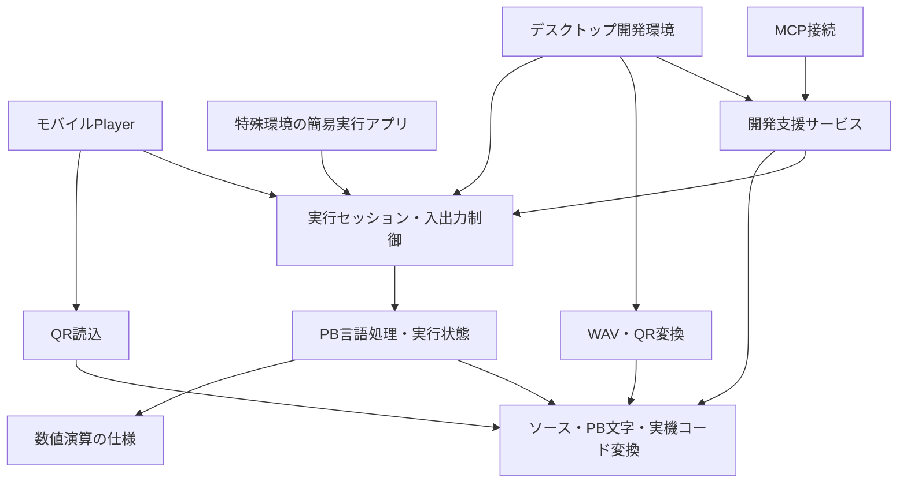

# システム設計・実装計画案

作成日: 2026-11-03
状態: 段階分けは検討案。段階Aの基本設計へ着手し、[基本設計書の第1版](basic-design.md)を作成済み。主要技術は[技術選定書](technology-selection.md)でKMP＋Composeを方針として選定。コード・試作は未着手。

参照: [要求仕様](requirements.md)、[BASIC詳細仕様（pokecom2実装基準）](basic-specification.md)、[旧版の実装調査](references/pokecom2-analysis.md)。

更新方針: BASIC仕様の出発点はpokecom2のコードとする。コード由来の詳細仕様を作成済み。マニュアル・実機は不明点・差異の照合に使い、資料が全てそろうまで設計を保留しない。

## 1. 基本方針

PBの実行仕様を共通の基盤として新たに設計し、その周囲へデスクトップの開発支援、Playerの実機風操作、特殊環境の簡易実行機能を組み合わせる。

旧版は文法・動作・文字・キー・保存形式の参照資産として活用する。UIと実行が密結合したクラス構造をそのまま移す方針にはしない。再利用できるデータや変換処理は、挙動を検証してから取り込む。

デスクトップ先行でも、最初に完成させるものは豪華な画面ではなく、「短いPBコードを、途中で止めながら正しく実行できる基盤」とする。初回公開の中心体験は、コードの動きと工夫を読み解けることに置く。

## 2. 構成案と依存関係

矢印は利用・依存の向き。下位の実行基盤からUIやMCPを参照しない。図は論理構成であり、各箱を別プロセスや別ライブラリにする決定ではない。

| 部分 | 担当すること | 境界として守ること |
| --- | --- | --- |
| ソース・文字・実機コード | 原文、エスケープ、PB文字、トークン、容量計数、交換用テキスト | 原文と正規化表現を混同しない。実機コードに旧アプリ内部番号を流用しない |
| PB言語処理・実行状態 | 構文、式、命令、変数、ページ、FOR/GOSUB、エラー | UI・ファイル・ネットワークへ直接アクセスしない |
| 数値演算 | 値の保持、演算、丸め、範囲、表示用整形 | 計算精度と表示精度を分け、実機比較の結果を反映可能にする |
| 実行セッション | 実行・停止・再開、入力要求、キー状態、表示送り、処理速度 | 待機中も操作へ応答できる。描画完了待ちを深い呼出し内でsleepし続けない |
| 開発支援 | 原文と命令の対応、状態表示、停止中の変更、診断 | Playerの通常実行は高機能な解析UIや履歴を必要としない |
| WAV・QR | 対象別の転送データ生成と復号、WAV診断 | 実行基盤へ音声・カメラ依存を持ち込まない |
| 環境別UI | デスクトップ、実機風Player、簡易UI | 同じソースの実行意味を独自に再実装しない |
| MCP | 開発支援の操作をAIへ提供 | AI用とUI用で別の実行・検証ロジックを作らない |

## 3. 実行基盤を先に設計する

### 命令と原文の対応

ソースを読み、命令ごとの実行用表現へ変換する構成を第一案とする。いきなり汎用の仮想CPUや複雑な最適化器は作らない。

- 各命令に、ページ・BASIC行番号・行内の順序・原文範囲・ソース版を対応付ける。
- 文字のエスケープ展開で長さが変わっても、原文の強調位置がずれないようにする。
- IFの条件部と後続命令、FOR/NEXT、GOSUB/RETURNをどう数えるか、利用者に見せる「1命令」の定義を先に決める。
- 実行用に分解しても元の圧縮された記述は保存する。読解表示と実機向け容量計数を、実行用表現のサイズから推定しない。
- 直接入力も同じ文法・式評価を使い、モードごとに利用できる操作を明示する。

### 状態と実行API

概念上、開始・一定量の実行・命令単位の実行・停止要求・再開・入力供給・キー更新・状態参照を扱えるようにする。具体APIは基本設計で定義する。

- 実行状態には、現在／次の命令、変数、FOR状態、GOSUB戻り先、ページ、表示・入力の継続状態を含める。
- 停止理由は、デバッガ停止、STOP文、PRINT待ち、INPUT待ち、表示送り、終了、エラーを区別する。
- 命令の途中でINPUTや表示待ちになっても、再開時に同じ副作用を二重実行しない。
- 「次に実行する命令」と「直前に完了した命令」を区別し、強調表示の意味を固定する。
- 連続実行は処理を小分けにしてホストへ戻す。ループ中や待機中も中断を受け付ける。
- キー、時間、乱数は置換可能な入力として扱う。試験で再現可能にするためで、タイムトラベル採用を意味しない。
- 停止中の変数変更は命令境界で検査して適用する。FOR変数を書き換えた場合の影響や、待機中に許す変更範囲を定義する。

### 容量と互換性の方針

文法・機種の適合と、容量の制限を別の設定にする。

- デスクトップは実機容量を超えても実行する。実装上の資源上限は別に設け、説明可能なエラーにする。
- Playerは544／1,568の選択に従う。DEFMによる動的な追加変数とプログラム領域の競合も確認する。
- 計数結果には、プログラム、追加変数、合計、対象容量、超過量、判定の確度を持たせる案とする。
- 実機仕様が未確認の構文や独自拡張を、容量だけ合うことを理由に「転送可能」としない。
- QRとWAVの出力は同じ対象適合判定を利用する。超過時の禁止／警告は未決で、先に黙示的な転送だけを防ぐ。

## 4. デスクトップ画面の第一案

外部エディタはソースの編集、アプリは実行と観察を担当する。

- LCDと入力キーを基本表示にする。
- 読み取り専用の原文表示と、命令ごとに分解した表示を対応付ける。
- 変数、FOR状態、GOSUB戻り先を一覧できる領域を設ける。常時全情報を表示する必要はなく、折り畳み等は画面検討で決める。
- 実行・停止・再開・命令単位の実行、選択変数の変更を提供する。
- 使用ステップ数と544／1,568に対する超過を見せる。

最初はファイルを明示的に読み込み、実行にはその時点のソース版を使う案とする。編集後の自動再読込は後から追加できるようにする。実行中の命令位置へ編集内容を無条件に差し替える機能は初回案に含めない。これは安全な初期動作の提案で、外部エディタ連携方法の確定ではない。

## 5. 技術選定と評価の進め方

[主要技術の選定](technology-selection.md)に基づき、共通実行基盤をKotlin Multiplatform、UIをCompose Multiplatformとする。主要5OSの開発効率・保守性を優先し、BrainのWindows CEとBrainuxは必要なら対象外とする。

数値演算は共通KotlinでBigDecimal相当の処理を行う方針。ionspinの多倍長演算を第一評価候補とし、Java BigDecimalとの差、丸め、数学関数、JVM/Android/iOSでの整合を評価する。

次の評価ではiOS向け共通基盤ビルドを早期に確認する。OS別カメラ・コントローラ・配布の詳細は後続設計とし、技術・依存の具体バージョンを互換性確認後に固定する。実装・試作の開始は別途判断する。

## 6. 段階ごとの実装計画案

各段階は小さな機能のまとまりごとに検証・レビューする。全命令の実装完了まで画面検証を待たない。一方、最初の試作を公開版の互換性保証と混同しない。

| 段階 | 主な成果物 | 完了条件 |
| --- | --- | --- |
| A: BASIC詳細仕様・基本設計 | 互換性表、代表コード、数値・文字・容量規則、命令境界と状態遷移、構成・API案 | 不明点に根拠・検証方法・保留理由が付き、試作の評価基準がある |
| B: 技術検証・選定 | 省略解析と原文対応、数値計算、待機を含む停止再開、移植性の小規模試作。採否を記す設計記録 | 主要要求を満たす技術構成を選べる。特殊環境の見通しと制約を説明できる |
| C: 最初の一連動作 | ファイル読込→代入・演算→PRINT/INPUT→12桁LCD、命令表示と単一命令実行 | UIなしでも実行でき、同じ処理を画面から動かせる。入力待ち・表示待ちから再開可能 |
| D: 互換実行・デバッグ拡充 | IF、GOTO/GOSUB、FOR/NEXT、ページ、変数・文字列、対象関数、容量、キーと速度、状態表示と変更 | 対象の代表コードが動作し、通常実行と命令単位実行の結果が一致 |
| E: デスクトップ初回公開 | 初回対象OS向け配布、旧ソース取込、必要な入力設定、日英UI、手順と既知の差異 | 公開対象の互換性表を満たし、外部エディタから読込・実行・観察・改造できる |
| F: 制作・転送の拡張 | WAV生成→正常WAV復号→録音WAV診断・波形解析、QR形式と出力、MCP連携 | 各転送の往復と容量適合を確認。AI操作もUIと同じ診断・実行サービスを通る |
| G: Player | Android/iOSの実機風UI、手入力・テキスト・QR、容量制限、ゲームコントローラ | デスクトップと同じコード・文字・結果を再現し、解析系UIを持たない |
| H: 特殊環境 | Brainux等の簡易ホスト。Windows CEはかなり低い優先度で別途判断 | 対象機器で実行でき、制限と未対応機能を説明できる |

Fの中のWAV・QR・MCPは独立して進められる部分がある。全部が完了するまでPlayerへ進めないという依存は設けない。PlayerのQR読込はQR形式の確定に依存する。

### 初回公開の範囲案

含める: 対象PB方言の互換実行、外部ソース読込、12桁LCDと対話入力、基本ソフトキー・ハードキー入力、命令位置・変数・FOR/GOSUB状態表示、一時停止・再開・命令単位実行・変数変更、容量表示、処理速度調整、日英UI。

Logical/Physical切替の詳細、最初に配布するOSと各OSでのキー対応はA〜Bで絞る。Windows/macOS/Linuxは最終的なデスクトップ対象だが、同時初公開か順次公開かは未決。

後続へ置く案: 高度なWAV解析、QR転送、MCP、ゲームコントローラ、Player、特殊環境。実機転送を初回の強いデモにする場合は、WAV生成のみを前倒しする選択肢がある。

採用未決のまま保つ: タイムトラベル、Web、公開投稿の場、実行中ソースの差し替え、VSCode専用拡張。これらを前提に初回の範囲を膨らませない。

## 7. 検証・受入の計画

- 命令・構文・数値等に対し、マニュアル、実機観測、旧版観測を別々に記録する。正解が不明な例は合格扱いにしない。
- 特に、括弧・空白の省略、IF後続、べき乗と符号、7/30文字、DEFM、容量境界、12/13桁を検証対象にする。
- 試験用ホストではキー・時間・乱数を固定できるようにし、ゲーム等の差を追えるようにする。
- 通常実行と命令単位実行、停止再開、変数変更のない場合の状態を比較する。
- 入力待ち・PRINT待ち・表示送り中の停止、終了、再RUNで状態が残らないことを確認する。
- 主要OSのビルドと共通実行試験を段階的に自動化する。UI検証ではLCD、キー、原文の強調位置、文字の見た目を確認する。
- WAV/QRでは往復だけでなく、既存の成功データ・実機転送も確認する。同じ誤りを共有するエンコーダとデコーダの往復だけで合格としない。
- 録音WAVは対象のサンプリング形式やノイズ条件を定め、復号不能な箇所を黙って補わず診断に出す。許容条件はSHARP版の機能とサンプルを見て決める。
- MCPはまず解析・検証の読み取り操作から入れ、生成ソースの差分確認・適用・実行を段階導入する。AI接続なしで基本の開発・実行が成立する構成にする。

## 8. 次に進める具体作業

段階A「BASIC詳細仕様・基本設計」に着手し、コード由来のBASIC仕様と基本設計の第1版を作成した。次は設計レビューと主要な未決事項の具体化を進める。

1. 作成済みのコード由来BASIC仕様をレビューし、旧版から継承する動作、不整合の修正、拡張の採否を整理する。
2. 代表的な既存ソースと旧版の実行結果を集め、静的読解だけでは確定しない箇所を確認する。マニュアル・実機は必要な差異へ絞って照合する。
3. 式・変数・文字・メモリと停止再開について、新版の採用仕様を定める。初回対象機種と互換範囲を決める。
4. 命令・原文対応と実行状態の基本設計、初回範囲案を確認する。
5. 選定したKMP＋Composeを前提に、十進数演算とiOSの早期評価の計画を絞る。Windows CE／Brainuxは主要5OSの進行条件にしない。

文書の完成を待って全てを一括確定する必要はない。設計に影響する事項を先に決め、表示の配置や外部エディタ再読込の細部は試作で判断する。

工期・日付は未見積もり。互換範囲、実機照合の可否、初回OS、Bの試作結果を確認した時点で、段階ごとの作業量を見積もる。
