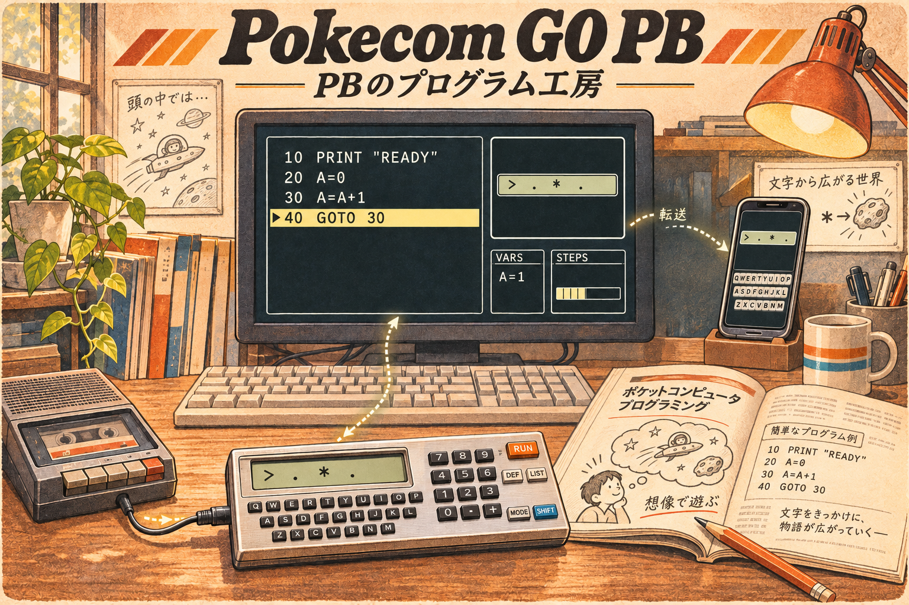

# Pokecom GO PB 要求仕様検討

更新日: 2026-11-03
状態: 企画・要求整理中。実装・技術選定は開始しない。

## コンセプトイラスト

制作・コード読解・ステップ数への意識と、スマホ／カセット経由の実機への持ち出しを表した企画イメージ。画面、BASICの記述、容量の数値、機器の外観は演出であり、PB-100の正確な仕様や採用済みUIを示すものではない。後続候補のモバイルも描いているが、デスクトップ先行の方針は維持する。

第2版の修正方針: PB-100は用意されたキャラクタのみを表示し、グラフィック表示や独自キャラクタ表示はできない。表示文字をゲームの情景へ脳内変換する楽しさも製品表現に含める。旧イラストのドット絵は誤解を招くため採用を取りやめ、画面は文字・記号の一行表示、想像上の情景は画面外の挿絵として区別した。厳密な文字セットやBASIC文法は引き続き未検証。

## 記録の区分

- 背景・意向: これまでの開発経験と、本プロジェクトで実現したいこと。外部資料による確認とは区別する。
- 検討案: 検討用の選択肢。採用を意味しない。
- 決定: 明示的に合意した方針。
- 未確認: 調査や資料による確認が必要な事項。
- 未決: 製品として選択する必要がある事項。

## 背景と意向

- 旧「Pokecom GO」にはAndroid向けのSHARP版とCASIO版がある。
- SHARP版はSC61860系のエミュレータであり、利用者が所持するROMが必要。SHARP系に特化したStudioを別途開発した。
- CASIO版は外部仕様から推測して独自実装したBASICインタープリタであり、CPUやROMのエミュレーションではない。
- CASIO版はROM不要で使えることもあり好評だった。旧版はAndroid専用。
- 今回はCASIO版のリメイクを独立プロジェクトとして検討する。単純移植にとどまらない魅力を作りたい。
- 操作感と編集の快適さ、即時利用、URL/QR共有、実行の可視化、ステップ・履歴巻き戻し、実機の制約を楽しむ制作、作品を読み改造する場などは候補であり、採用決定ではない。

## 決定済みの進め方

- 初回リリースはデスクトップ先行とする。モバイルPlayerは後続の希望として扱い、具体的な時期は未決。
- 対象利用者は旧PB-100愛好家とする。
- SHARP版Studioとは別プロジェクトとする。
- まず企画と要求仕様を整理し、実装はまだ始めない。
- 技術選定は製品の方向性と互換性要求を整理した後に行う。
- 機種仕様や機種差を推測で確定しない。
- 候補機能をすべて採用する前提にしない。

## プロジェクト名

- 採用名: **Pokecom GO PB**。
- コンセプト表現: **PBのプログラム工房**（正式な副題としての固定は未決）。
- SHARP版Pokecom GO Plusと略称PGPが重複する。略称の運用は未決。
- 表記運用の検討案: 利用者向けには「Pokecom GO PB」、文脈が明確なら「GO PB」を使い、両プロジェクトを指し得る場ではPGP単独を避ける。
- デスクトップ／モバイルの製品名候補は引き続き「Pokecom GO PB Studio / Pokecom GO PB Player」。個別製品名の最終確定は未決。
- 名称の重複・商標等は未調査。

以下は選定時の記録。

私が開発しているSHARP版の製品名は「Pokecom GO Studio / Player」、総称するプロジェクト名は「Pokecom GO Plus」。

命名方針の検討案:

- 旧Pokecom GOとのつながりを残し、SHARP版と区別できる固有部分を付ける。
- 総称とデスクトップ／モバイルの製品名の関係をそろえる。
- PB-100愛好家が対象だと分かることを優先し、懐かしさだけでなく制作環境としても使える名前にする。

比較した候補（商標・既存製品名・ドメイン・ストア上の重複は未調査）:

| 総称候補 | デスクトップ／モバイルの呼称例 | 意図・留意点 |
| --- | --- | --- |
| Pokecom GO PB | Pokecom GO PB Studio / Pokecom GO PB Player | 既存ブランドとPB系の対象を端的に示す。現時点の第一検討案。Studio単独の略称ではSHARP版と混同するためPBを残す |
| PB Workshop | PB Workshop / PB Workshop Player | 読解・制作・職人芸を前面に出す。旧Pokecom GOとの関係は副題などで補う必要がある |
| Pokecom GO BASIC | Pokecom GO BASIC Studio / Pokecom GO BASIC Player | 独自BASIC実行環境であることを強調する。対象がPB系であることやSHARP版との差は名前だけでは伝わりにくい |

命名上の確認結果: 「Pokecom GO PB」を選択し、既存ブランドを継承する。

## 製品コンセプト候補（検討案・未採用）

開発規模は候補間の相対比較。対応機種や互換性の深さが未決のため、工数見積もりではない。

| 案 | 中心体験・主な対象 | 公開時のデモ | 初回に絞る候補 | 相対規模・主な難所 |
| --- | --- | --- | --- | --- |
| A: すぐ遊べる、手元のポケコン | 当時の利用者が、懐かしい操作で短いプログラムを再び楽しむ | 起動して同梱ゲームを実行し、数字を一つ書き換えて遊び方を変える | 対象を絞った互換動作、実機風操作、快適な編集、ローカル保存・取り込み、少数の作品 | 小〜中。互換性・入力・表示の再現が中心。共有サービスや履歴巻き戻しは初回の中心にしない |
| B: 遊んで、読んで、改造できるポケコン作品帳 | 当時の利用者と初めて触れる人が、作品からBASICの制作に入る | URL/QRでゲームを開き、ソースを読んで改造し、自分の版を共有する | 即時実行、作品とソースの一体表示、編集、自分の版として保存、限定的な共有 | 中〜大。Web等での即時利用、作品の再現性、共有形式が難所。公開投稿・検索・アカウント付きコミュニティは別途検討 |
| C: 動きが見えるポケコンBASIC | 仕組みを知りたい利用者や制作者が、短いプログラムの動作を理解する | 実行を止め、変数とループを追い、直前の状態へ戻って分岐を見直す | 実行行・変数表示、一時停止、ステップ実行。巻き戻しは調査後に採否を判断 | 大。入力・乱数・時間などを含む状態の記録と再現、説明表示の分かりやすさが難所 |

初期の比較ではBを有力案とした。その後の構想を踏まえ、「愛好家の制作・読解と持ち出し」を中心とする案に整理する。いずれも未採用。

## 追加の構想

対象利用者は旧PB-100愛好家とする。以下は実現したいこととして提示された希望であり、初回リリースへの採用決定ではない。

- Android/iOSで持ち出す。旧版のモバイル体験を踏襲する。
- Windows/Mac/Linuxに対応したい。Windows CEやBrainuxも可能なら検討する。
- 独特のBASICと、ステップ数を節約する職人芸のコードを読み解き、動きを追いたい。
- 昔の雑誌などの公開コードを気軽に実行したい。
- デスクトップで入力・デバッグし、モバイル版Playerへ簡単に転送したい。SHARP版Studio/Playerと同様の関係を想定している。
- 入力コードをカセット出力フォーマットへ変換し、実機へ転送したい。変換スクリプトは以前に私が作成し、解説付きで公開している。
- AIによるソース分析、新規作成、ステップ数節約のリファクタリング検討案、作品公開用の説明資料作成を行いたい。
- ソースのQRコード化と、スマホでの読み取り・デコードを楽しみたい。

## 現在のコンセプト案（検討案）

「あのコードを読み解き、磨いて、持ち出す」――旧PB-100愛好家のための制作・実行環境。

デスクトップで入力・実行・読解・デバッグし、同じ作品をスマホへ持ち出す。カセット変換で実機にも接続する構想。製品名やアプリの分割方法は未決。

- 中心価値候補: 昔のプログラムが動くだけでなく、限られたステップ数に込められた工夫を理解し、自分で磨けること。
- 公開デモ候補: 入力した短い作品を動かす→変数・実行位置を追う→同じ動作でステップ数を減らす→スマホへ渡して遊ぶ。実機への転送は独立した追加デモ候補。
- 初回の核の候補: 絞った対象機種の互換実行、デスクトップ編集・保存・取り込み、ステップ数表示、基本デバッグ、モバイル実行、簡単な受け渡し。
- 後続候補: 高度な履歴巻き戻し、AI連携、公開作品の投稿・検索。カセット変換の初回採用は既存資産と優先順位の確認後に決める。
- Windows CE/Brainuxは探索対象。主要OSと同じ対応保証を約束するかは未決。
- Webは現時点の必須要件ではない。即時実行や受け渡しに必要かを今後判断する。

互換実行と現代的な制作支援を分け、編集・解析・AIの支援を利用しても実機向けのコードと制約を維持できる構成を検討する。具体的な制約・判定方式は未確認。

## 当時の確認事項

確認済みの方針:

- デスクトップ先行（決定）。
- 旧版はPB-100専用で、互換の派生機種を含む。対象の例はPB-100 / PB-100F / PB-110 / PB-300など。各機種の差異や旧版で再現していた範囲は未確認。列挙された全機種を今回の初回で個別に再現する決定とは扱わない。

継続して検討する事項:

1. 初回の互換性は、まずPB-100を基準とし、派生機種固有の差異は確認後に扱う方針でよいか。それとも初回から外せない派生機種固有の動作があるか。
2. 初回のデバッグは、実行行・変数・FOR/GOSUBの状態表示、一時停止・ステップ実行を中心にする案でよいか。履歴巻き戻しも初回の必須か。

## デスクトップ先行を受けた初回範囲案（未採用）

- 中心体験: 昔のコードを入力する→動かす→仕掛けを追う→ステップ数を意識して改造する。
- 初回の核の候補: 互換実行、編集、保存・取り込み、コード容量としてのステップ数表示、基本デバッグ。
- カセット変換: 既存スクリプトと解説を確認し、初回に含めるか判断する。
- 後続: モバイルPlayerと簡単な転送。QRによる受け渡しもここへつながる候補だが、デスクトップでのQR出力をいつ提供するかは未決。
- AI連携、履歴巻き戻し、Web、公開投稿機能、Windows CE/Brainuxの優先順位は未決。デスクトップ先行だけを根拠に対象外とはしない。
- 初回デスクトップの対応OSと配布方法は未決。

## 仕様決定前の確認事項

- 「ステップ数」はコード容量としての意味で扱う想定。実行ステップの計測やステップ実行とは区別する。対象機種の計数規則は資料・既存実装で確認する。
- QRはソース自体を含める方式とURLを含める方式を区別する。オフライン利用、最大作品サイズ、文字の符号化、分割QRの要否は未確認。現時点でどちらかに固定しない。
- AIの検討案が文法・容量制約に適合し、動作を維持することをどう確認するかは未決。AIの説明と検証済みの事実を区別する必要がある（検討案）。
- 雑誌コードを利用者が取り込む機能と、アプリ側で同梱・再配布する作品の選定は別の要件として整理する（検討案）。
- カセット変換スクリプトと公開解説を後で確認する。目的は対象機種・入力形式・出力形式・実機転送手順・検証実績・再利用条件の把握。現時点では閲覧・検証していない。

## 未決事項と初回リリースの範囲

初回リリースの採用機能はまだ決定していない。上の表は比較用の候補。

| 論点 | 現状・次の確認 |
| --- | --- |
| 対象利用者と提供価値 | 旧PB-100愛好家が対象。制作・読解・持ち出しの中心体験を検討案中 |
| 中心コンセプト・デモ | 追加の構想を踏まえたコンセプト案を参照。未採用 |
| 対応機種 | 旧版はPB-100および互換派生機種（例: PB-100/100F/110/300）。今回の初回の機種別保証範囲と差異は未決・未確認 |
| BASIC互換性 | 文法、数値、文字、エラー、実行順などの基準を今後定義する |
| 表示・キー・メモリ | 対象機種とともに互換性の対象を整理する。具体仕様は未確認 |
| 実機互換と現代的拡張 | 編集などの支援機能と、実行結果に影響する拡張を分けて検討する（検討案） |
| プラットフォーム・配布 | デスクトップ先行は決定。Windows/Mac/Linux、後続のAndroid/iOSを希望。Windows CE/Brainuxは可能なら検討。初回対応OS・配布方法は未決、技術選定も未実施 |
| 編集・実行・保存・取り込み・共有 | 中心体験を決めた後に利用の流れと必要条件を定義する |
| 旧版のコード・資産・既存プログラム | 再利用方針・移行対象・形式とも未確認 |
| 初回と後続の境界 | コンセプト選択後に必須・後続・対象外を明示する |
| 技術的不確実性 | 互換性の基準、旧版の再利用性、共有作品の再現性、履歴再生の実現性。試作は別途合意後 |
| 検証 | 資料・実機・サンプルを基に期待結果と比較する方針を今後定義する |

## 後で必要になる資料（現時点で提出は不要）

- 旧CASIO版の対応機種一覧・説明書・画面: 既存ユーザーに提供していた範囲を把握するため。
- 旧版のソースと権利関係: インタープリタ・入出力・保存形式の分離状況と再利用可能範囲を確認するため。技術選定後ではなく、移行要求を決める際に確認する。
- 旧版で保存したプログラムと実行例: 取り込み・移行の期待結果を定義するため。
- 対象実機のマニュアル、利用できる実機、掲載プログラムと利用条件: 機種差、境界動作、表示や入力の検証基準、同梱・共有できる作品を確認するため。

## 決定履歴

- 2026-11-03: 要求整理を開始。企画段階の進め方を記録。コンセプト3案を検討案。製品の方向性・初回範囲は未決。
- 2026-11-03: 対象利用者を旧PB-100愛好家と明示。追加希望を記録し、制作・読解・スマホ／実機への持ち出しを軸とする案を検討案。初回範囲・対象機種は引き続き未決。
- 2026-11-03: デスクトップ先行を決定。旧版の対象を記録（PB-100/100F/110/300など）。今回の機種別互換範囲は未決。
- 2026-11-03: プロジェクト名の検討を追加。SHARP版の総称がPokecom GO Plusであることを記録。命名候補は未採用・名称重複等は未調査。
- 2026-11-03: プロジェクト名に「Pokecom GO PB」を採用。「PBのプログラム工房」をコンセプト表現として記録。PGPの略称重複と製品別名称の運用は未決。
