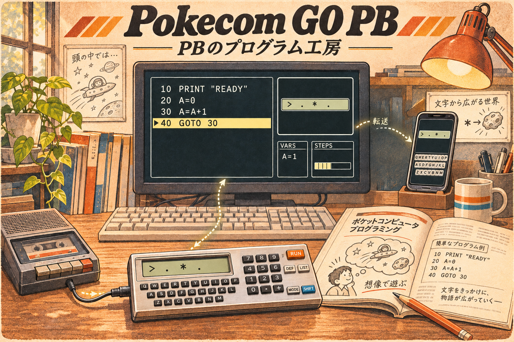

# Pokecom GO PB 要求仕様

更新日: 2026-11-03 / 第1次統合版

企画・要求整理段階。実装・技術選定は未着手。本書は最終像を整理するものであり、全機能を初回公開に含めるものではない。

## 1. 記録と状態の扱い

- 決定: 本プロジェクトで採用した方針。
- 要求: 本プロジェクトで実現したい最終像。初回への採用を意味しない。
- 検討案: 段階分けや設計などの選択肢。採用は未決。
- 未決: 製品上の選択が残る事項。
- 未確認: 資料・実機・旧実装等による確認が必要な事項。

実機に関する具体的な数値や挙動には、これまでの開発経験に基づく記述を含む。本プロジェクトでの資料照合・実機検証は未実施。

原文は [追加インプット記録](input-notes.md) に保持する。初期の検討案・命名候補等は [統合前の検討記録](requirements-discussion-2026-11-03.md) に保存した。現在の要求の参照先は本書とする。

## 2. 製品の目的と対象

### 決定・背景

- プロジェクト名は **Pokecom GO PB**。対象利用者は旧PB-100愛好家。
- SHARP系のPokecom GO Plus（Studio / Player）とは別プロジェクト。
- デスクトップ先行。機能はインクリメンタルに実現する。
- 技術選定前に製品の方向性と互換性要求を整理する。アーキテクチャに影響する事項を先に検討する。
- 旧CASIO版はAndroid向け。CPU・ROMエミュレーションではなく、外部仕様から独自に実装した互換BASICで、ROM不要だった。
- 旧版はPB-100と互換派生機種向け。例: PB-100 / PB-100F / PB-110 / PB-300。今回の機種別保証範囲は未決。

### コンセプトの整理案

**PBのプログラム工房 — あのコードを読み解き、磨いて、持ち出す。**

昔の雑誌や自作のコードを動かし、独特のBASICとステップ数節約の工夫を読み解く。デスクトップで動作を追って改造し、スマホや実機でも楽しむ。限られた文字表示を情景へ脳内変換する遊びも大切にする。

「PBのプログラム工房」をコンセプト表現として使う。正式な副題への固定は未決。デスクトップ／モバイルの正式製品名（Studio / Player等）、略称の運用、名称重複等の確認も未決・未実施。

ROM不要で起動後すぐ利用できる体験は、旧版の価値を継承する要求として扱う。

## 3. 二つの利用体験

| 観点 | デスクトップ | Player |
| --- | --- | --- |
| 主目的 | コードを読み解き、動作を追い、改造・デバッグする | 懐かしい実機風の操作で持ち出して使う |
| 見た目・操作 | 実機操作の再現を優先しない。LCD中心に情報を表示 | デフォルメを許容しつつ実機へ極力寄せ、旧Pokecom GOの見た目を踏襲 |
| 編集 | VSCode等、利用者の外部エディタを使う | 実機仕様に寄せた表示・編集・行入力制限 |
| 容量 | 容量による実行制限なし。使用ステップ数と閾値超過を表示 | 544 / 1,568ステップの2種類 |
| デバッグ | 命令単位の実行制御、状態表示・変更 | プログラムのトレースは不要 |
| カセット関連 | ソースとWAVの相互変換、波形解析 | 不要 |
| 転送・ソース入力 | ソースのQR化、実機向けWAV出力 | QR読み取り、通常のテキスト読み取り、手入力 |

表は最終像の要求を整理したもの。具体的な画面構成・機種差の扱いは未決。

## 4. 共通の互換実行・入出力要求

| ID | 要求 | 未確認・未決の詳細 |
| --- | --- | --- |
| C-01 | PB系BASICの外部仕様に近い動作を再現 | 命令・関数・エラー・機種差の網羅表、保証範囲 |
| C-02 | コマンド入力とプログラム実行で、演算優先順位を含む一貫した式評価 | 同じ評価ロジックの共通化を検討する。具体設計は未決 |
| C-03 | PB独自の省略記法に対応 | コマンドと引数間の空白省略、閉じ括弧省略等の成立条件とその他の作法 |
| C-04 | 小数点計算で不要な誤差を出さない | 旧版はBigDecimalを使用。今回の方式、実機の桁数・丸め・範囲・関数精度は未確認。全計算の数学的無誤差を保証する意味にはしない |
| C-05 | LCDは12桁。用意されたキャラクタを表示 | 従来の記載の16桁は12桁へ訂正済み。文字セット・記号・表示属性等は未確認。グラフィックや独自キャラ表示はしない |
| C-06 | PRINTの長い内容を自動スクロールして全体を見せる | 12桁ちょうど／超過時の境界、速度、入力や停止との関係 |
| C-07 | コマンドプロンプト的な対話入出力を扱う | 入力待ち、編集、実行表示、キー受付の関係。汎用UIが必要という課題認識 |
| C-08 | 特殊記号は私が作成・公開したpbsavea.pl v0.5のエスケープ定義に従う | [対応表と入力規則](references/escape-codes.md)。25種類とバックスラッシュ表記を確認。グリフ、出力正規形、未知入力の処理は未確認・未決 |
| C-09 | BASIC処理速度を調整 | CPUエミュレーション速度ではない。調整範囲・基準・待ち時間との関係 |
| C-10 | デスクトップ／Playerともゲームコントローラに対応 | ボタン割当・同時押し・長押し等 |
| C-11 | 表示言語を日本語／英語で切替 | UI翻訳対象、実機由来のメッセージ等の扱い |

容量の「ステップ数」と、デバッグの「ステップ実行」は別概念として扱う。

## 5. Playerの要求

- P-01: 通常のコマンド入力、四則演算など、実機相当の通常利用を可能にする。
- P-02: プログラムの表示・編集、1行の入力可能文字数を実機仕様へ寄せる。具体的な文字数等は未確認。
- P-03: メモリ使用量を表示する。ユーザーメモリは544ステップ／拡張時1,568ステップの2種類。
- P-04: プログラムの実行・停止・再開を可能にする。停止原因ごとの状態保持や再開条件は未確認。
- P-05: 上下カーソルでプログラムリストを順方向・逆方向へ送る。旧版の利便性を継承する実機からの拡張。
- P-06: ソース入力は、QRコード読み取り、通常のテキスト読み取り、利用者による手入力の3通りとする。テキストの具体的な読み取り経路（ファイル、貼り付け等）は未決。
- 対象外: プログラムのトレース、プリンタ関連処理、カセット入出力。

「実機でできること」の全機能保証を現時点で意味するものではない。上記の対象外を踏まえ、詳細な互換範囲を定義する。

## 6. デスクトップの要求

- D-01: 外部エディタで作成・編集したソースを利用する。内蔵フルエディタは現在の要求に含めない。ファイル保存・読込方式、変更の自動反映、実行中や停止中の変更反映は未決で、構成を踏まえ、開発時に判断する。
- D-02: LCDを中心に実行結果を表示する。
- D-03: 変数、現在の行番号・実行位置、FORループのカウント等、実行状態を可視化する。GOSUB等の表示詳細は未決。
- D-04: ソース上の現在実行位置を視覚的に示す。外部エディタとは別ウィンドウでもよい。
- D-05: 一時停止、命令単位のステップ実行、停止中の変数変更を可能にする。1行内に複数ある命令も追えるようにする。
- D-06: 命令ごとに分解した実行表示を検討する。原文ソースとの対応表示も検討案とする。表示方法は未決。
- D-07: 使用ステップ数による実行制限はかけない。現在の使用量と544／1,568等の閾値超過が分かる表示を行う。閾値の選択方法や併記方法は未決。
- D-08: ソフトウェアキーボードとPCハードキー入力に対応。ハードキーはLogical / Physicalを切り替える。具体的なマッピングは未決。
- D-09: ソース→実機転送用WAV、WAV→ソースの相互変換。
- D-10: WAVデコード時の波形解析等。SHARP版Pokecom GO Studioと同程度を希望。具体的な対象機能は既存版を見て定義する。
- D-11: ソースをQRコード化する。URLのみの共有ではなく、ソースをPlayerへ渡せることが要求。格納形式・最大容量・分割・オフライン条件は未決。
- D-12: Playerや実機への転送時、転送先容量超過を黙って通さず、禁止または警告する。どちらにするか、WAV保存・QR出力等でどう適用するかは未決。
- D-13: MCPの仕組みでAI連携し、既存ソース解析、新規プログラム生成を可能にする。ステップ数節約のリファクタリング提案、作品公開用の説明資料作成も最終像に含む。公開する操作やAI提案の適用・検証方法は未決。

## 7. 実機互換と制作支援の関係

要求として明らかな差:

- Playerは実機風の操作と容量制約を重視。ただし逆方向のリスト表示は追加する。
- デスクトップは同じPB系コードを扱いつつ、容量制限を外して読解・デバッグを支援する。
- 実機／Playerへの持ち出しでは、転送先の容量適合を確認する。

検討案: PBの実行意味と、操作UI・デバッグ機能・容量判定の方針を分けて定義する。デスクトップの支援機能が、気付かないうちにPB以外の言語仕様を持ち込まないようにする。言語拡張モードの採用は未決で、容量制限なしの要求を文法拡張の要求とは扱わない。

## 8. 対応環境・配布・資産

- デスクトップ: Windows / macOS / Linux。LCD表示と、外部エディタで編集したソースの入力、各種デバッグ、AIを活用した開発を提供する。
- Player: Android / iOS。実機に近い操作感を提供し、解析系機能は載せない。QR・テキスト・手入力等の既存要求は維持する。
- 特殊環境: Brainux等で、デバッグなし・プログラム実行のみなどの機能制限を許容して動かしたい。対応の優先度は低いが、それを見越したアーキテクチャにしたい。
- Windows CEでも動かしたい。対応優先度はかなり低いが、将来の対応を見越したアーキテクチャ上の検討対象とする。移植可能性は未確認。
- 特殊環境ごとの対象バージョン・機器・必須機能・入出力・配布方法・対応保証は未決。Brainux／Windows CE対応を初回公開の条件とはしない。
- デスクトップ先行以外の公開順序、初回対応OS、配布方法、価格・ライセンス方針は未決。
- Web版、URL共有、投稿欄のような公開作品の場、履歴を戻るタイムトラベル実行は初期候補。採用未決で、最終像の確定機能に混ぜない。
- 旧版コードは参考にできるが、ゼロからの作り直しも選択肢。再利用・再実装の方針は未決。
- 私が作成・公開したカセット変換スクリプトと公開解説がある。再利用可能性は未確認。
- 既存ユーザーのソースを活用したい。旧保存形式・エスケープ表現・互換性・移行手順は確認が必要。
- 雑誌コードを利用者が入力・取り込む機能と、作品をアプリへ同梱・再配布することは区別して検討する（検討案）。同梱作品・利用条件は未決。

## 9. 段階的な進め方案（検討案・未採用）

初回範囲の決定は「デスクトップ先行」のみ。以下は実現順序のたたき台とし、実装開始は別途判断する。

| 段階 | 目的と範囲案 | 次へ進む判断材料 |
| --- | --- | --- |
| 要求・資料調査 | 対応機種、文法・式評価・数値・文字・容量計数・入出力を確認。命令位置と停止・再開状態の定義を先に整理 | 代表的なコードの期待動作と互換性の範囲を説明できる |
| 初回デスクトップ案 | 外部ソース読込、互換実行、12桁LCD・対話入力、必要なキー入力、容量計数と閾値表示、実行位置・変数・ループ状態、命令単位の停止・実行・変数変更 | 代表プログラムを入力し、動作を追い、改造できる |
| デスクトップ拡充 | WAV相互変換・波形解析、QR出力、MCP連携、コントローラ、日英切替等を段階導入 | 各機能の受入条件を満たす。正確な順序は未決 |
| Player | 実機風UIと容量制限、QR読込、持ち出して遊ぶ体験 | デスクトップとの実行結果・文字・容量判定の整合 |

初回公開での対応OS、速度調整・キー切替等の詳細な採用範囲も未決。後続機能でも、文字表現・実行状態・外部連携の境界へ影響する要求は先に検討する。

公開デモ案: 雑誌風の短いコードを読み込む→命令単位で工夫を追う→変数を変えて動作を確認→コードを磨いて使用ステップ数を減らす。後続デモではQRでPlayerへ渡す、WAVで実機へ送る流れを加える。作品の採用と動作は要確認。

## 10. アーキテクチャに影響する確認事項（技術選定前）

以下は設計上の検討論点であり、実装方式の決定ではない。

1. **命令と原文の対応**: 省略記法や1行内の複数命令を解析し、元ソースの位置・行番号とデバッグ表示を対応付けられるか。
2. **実行状態の境界**: 入力待ち・スクロール・一時停止・命令実行・変数変更をどう定義するか。FOR/GOSUB等の内部状態をどこまで見せるか。
3. **計算仕様**: 直接入力とプログラム内の式評価を共通に扱う要件、数値精度・丸め・エラー等の実機適合。
4. **入出力と速度**: 複数UIで同じBASIC挙動を扱えること。処理速度と表示スクロール・キー入力の関係。
5. **文字・ソース・容量**: 旧エスケープ、実機文字、編集用テキスト、WAV、QRで情報を失わないこと。使用ステップ数の正確な算定。
6. **外部機能との接続**: Player・WAV・QR・MCPが参照するプログラムや実行状態の範囲。外部エディタ変更の反映方法は後で選べる余地を検討。
7. **環境差**: デスクトップの開発環境、モバイルPlayer、特殊環境向けの機能を絞った実行環境を区別する。特殊環境への対応は低優先度だが、デバッグ・解析・AI連携や高機能なUIを搭載せずにBASIC実行を提供できる構成を初期から検討する。実行部分と表示・入力・開発支援を分離する設計が候補（検討案）。共通化の単位、言語・ランタイム・UI技術等は未選定で、特殊環境への移植可能性は未確認。

履歴巻き戻しは採用未決。必要なら実行状態・入力・乱数・時間の記録への影響を設計前に確認するが、現段階で必須設計とはしない。

## 11. 必要な資料と検証の進め方（検討案）

### 既存の技術資料

- [カセットI/Fの話（casio編）— digihori](https://digihori.jimdofree.com/index/cassette-io-casio/)（私がまとめて公開した技術資料）。2026-11-03に本文・予約語表を閲覧し、図版へのリンクも開けることを確認。
- 内容: カセット信号の方式、WAV生成、PB-100の保存形式・内部表現、キャラクタコード、予約語コード。リンク先の自作ツール `pbsavea.pl` version 0.5を取得し、静的に確認済み。原本を保存し、[調査記録](references/pbsavea-review.md)と[エスケープ仕様](references/escape-codes.md)を作成。実行・実機検証は未実施。
- 主な参照先: WAV相互変換、文字とエスケープ表現の対応、BASICのトークン化、容量計数の調査。資料には文字としてのコロンと命令区切りの内部コードの違い、括弧を含む予約語についても記述がある。
- キャラクタ表やフォーマット図は画像。厳密な転記・図の各値の確認、実機との照合は未実施。記事中の実装上の近似や推測を、実機の確定仕様と混同しない。

### 次に確認する資料

| 資料・資産 | 確認目的 |
| --- | --- |
| 旧CASIO版ソース・説明書・画面 | 省略文法、演算、表示・入力、容量計数、既知の互換範囲と拡張、エスケープ一覧を把握 |
| 旧版で保存した実際のソース | 保存形式の移行と記号の往復変換を確認 |
| 実機マニュアル・機種別資料・利用できる実機 | 仕様の根拠、機種差、端の動作を確認 |
| 雑誌等の代表コード・自作コード | 実際の省略・圧縮記法やゲーム入力を検証。同梱する場合は利用条件も確認 |
| カセット変換スクリプト・解説・実機で成功したWAV | フォーマット、機種、変換手順、既知の実績・制約を確認 |
| SHARP版Studioの波形解析画面・機能一覧 | 「同程度」の具体的な範囲を定義 |

検証方法案:

- 命令・関数・数値・文字・表示・入力・容量について、資料上の根拠と実機／旧版の観測を分けた互換性表を作る。旧版の挙動を実機の正解と同一視しない。
- 省略文法と演算優先順位、桁・丸め・範囲境界、12桁と長文スクロール、メモリ閾値の前後を小さなプログラムで確認する。
- 通常実行と命令単位実行で結果が一致すること、停止・再開・変数変更の状態が説明できることを確認する。
- 同じソースをデスクトップとPlayerで比較し、意図した容量・操作差以外の違いを確認する。
- ソース→QR→ソース、ソース→WAV→ソースの往復と、実際の実機転送を確認。WAVは正常データに加え録音条件の異なる例を集め、対応範囲を定義する。
- MCP経由の生成・改変も、文法・容量の検査や実行確認を行う方法を決める。AIの説明だけで互換性や同値性を保証しない。

今後の試作候補は、曖昧な文法の解析、実機相当の数値計算、命令と原文の対応表示、非同期入力と停止、WAV解析・QR容量。いずれも目的と評価条件を決め、実装開始の合意後に実施する。

## 12. 未決事項の一覧

| ID | 未決・未確認事項 | 決める時期の目安 |
| --- | --- | --- |
| O-01 | 対象機種と機種別保証範囲 | 互換性の基準策定時 |
| O-02 | 文法・数値・エラー・文字・行長・メモリ計数の詳細 | 実行基盤の設計前に主要部分を確認 |
| O-03 | 初回対応OS・機能・配布方法 | 初回範囲の合意時 |
| O-04 | 命令分解表示、実行位置、ループ等の見せ方 | デバッグ画面の検討時 |
| O-05 | 停止中の変数変更の範囲、停止・再開の詳細 | 実行状態の定義時 |
| O-06 | 外部ソースの反映方法 | 構成・試作を見ながら判断 |
| O-07 | 転送先容量超過の禁止／警告と適用箇所 | 転送機能の仕様化時 |
| O-08 | QR形式・サイズ・分割・読取方法 | 転送機能の仕様化時 |
| O-09 | WAV解析・復号の対応品質と具体機能 | 既存資産確認後 |
| O-10 | MCPの提供機能とAI生成物の確認・適用方法 | 連携境界を決める時 |
| O-11 | 旧版再利用／新規実装、移行範囲 | 旧コード・形式確認後 |
| O-12 | Web、作品公開の場、タイムトラベルの採否 | 中心体験と開発規模を見て判断 |
| O-13 | 製品別名称・正式副題・略称・名称重複 | 公開準備まで |

## 13. コンセプトイラスト

第2版をコンセプトイラストとして採用した。各画面は文字・記号の一行表示にし、想像上の情景は画面外の挿絵で表す。コード、文字形状、機器の外観はイメージであり、正確な実機仕様や採用UIではない。描かれたモバイルも最終像の一部で、デスクトップ先行は維持する。第1版は独自グラフィック表示の誤解を招くため不採用。

## 14. 主要な決定・更新履歴

すべて2026-11-03。

- 企画・要求整理から開始。SHARP版と別プロジェクトにする。
- 対象は旧PB-100愛好家、デスクトップ先行、名称はPokecom GO PB。
- コンセプトイラストの表示を修正し、第2版を採用。
- 最終像の機能を記録し、段階的に進める方針を決定。
- デスクトップは容量制限なし、使用量・閾値超過を表示。デバッグは命令単位。
- 転送時の容量超過は転送禁止または警告が必要。具体方式は未決。
- 表示幅は16桁から12桁へ訂正。
- 要求全体を整理し、第1次統合版を作成。段階分け・初回範囲・設計論点は検討案として区別。実装と技術選定は未着手。
- Playerのソース入力をQRコード読み取り・通常のテキスト読み取り・手入力の3通りと明示。
- 私が作成・公開したpbsavea.pl v0.5を取得・静的調査。特殊記号のエスケープは同スクリプトの定義に従うことを記録。
- 実行環境の役割を明確化。Windows/macOS/Linuxはデバッグ・AI付き開発環境、Android/iOSのPlayerは実機風操作で解析系なし。Brainux等は実行のみ等の制約を許容し低優先度で対応したいが、その構成上の余地は初期から考慮する。
- Windows CEも将来の対応対象として記録。優先度はかなり低く、実現性・対象バージョン等は未確認・未決。
